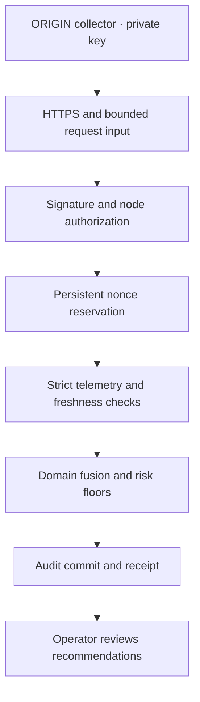

# ABYSSAL security design

## Trust boundary

CENTAURUS V4 accepts telemetry from registered ORIGIN collectors and produces defensive recommendations. It has no command execution, shell, plugin loading, firmware installation, or arbitrary outbound request interface. The primary threats addressed here are forged events, in-transit changes, replay, cross-node impersonation, malformed payloads, resource exhaustion within application limits, and local audit modification without access to the audit key.



An authenticated source is not an independently attested source. MFA, secure boot, firmware hashes, threat intelligence scores, and sensor readings are supplied observations. The service does not validate a passkey, Google Authenticator code, TPM quote, vendor firmware signature, or external threat feed itself. A stolen device key or compromised collector can fabricate plausible telemetry. Store device private keys in a secure element where supported, restrict collector privileges, and validate important observations against independent evidence.

## Request signature protocol

`POST /v4/assess` accepts `application/json` only. Send four case-insensitive headers:

| Header | Value |
| --- | --- |
| `X-Centaurus-Key-Id` | Provisioned ID, 3–64 letters/digits/`_`/`.`/`-`, starting with a letter or digit |
| `X-Centaurus-Timestamp` | Ten decimal digits representing Unix seconds |
| `X-Centaurus-Nonce` | A fresh URL-safe random token, 22–64 characters; toolkit uses 24 random bytes |
| `X-Centaurus-Signature` | Lowercase hexadecimal Ed25519 signature, 128 characters |

Sign the ASCII encoding of these seven lines, separated by a single LF, **without a trailing LF**:

```text
CENTAURUS-ABYSSAL-V4
<key-id>
<timestamp>
<nonce>
POST
/v4/assess
<lowercase SHA-256 hex of exact transmitted body bytes>
```

Use `app_v4.security.sign_headers` as the reference implementation. No JSON normalization is performed: whitespace changes require a new signature. Do not reserialize after signing. The server rejects query parameters, encoded path variants, duplicate security headers, compressed request bodies, duplicate JSON keys, non-finite numbers, unexpected fields, naive timestamps, and coerced string booleans. There are no redirects to the protected endpoint. Failed validation consumes an authenticated nonce; retry with a fresh nonce and signature.

The default transport signature window is ±60 seconds, checked again after reading the body. Event timestamps have a separate maximum age of 300 seconds and at most five seconds of future skew. Nonces remain reserved until their signature can no longer be accepted. Reservations and quotas survive process restart and are serialized between workers using SQLite transactions.

## Policy semantics

V4 retains V3's four-domain weighted fusion and mission profiles, then applies non-dilutable floors:

| Observation | Minimum score | Minimum risk |
| --- | ---: | --- |
| Missing MFA or runtime integrity evidence | 0.35 | guarded |
| Explicitly unverified MFA | 0.35 | guarded |
| Failed secure boot | 0.65 | elevated |
| Firmware mismatch or memory tampering | 0.85 | critical |
| Honeytoken or canary credential use | 0.85 | critical |
| Decoy service contact | 0.65 | elevated |
| Open enclosure plus vibration above 0.75 | 0.80 | critical |
| C2 score above 0.8 plus reputation above 0.7 | 0.80 | critical |
| Impossible travel plus privilege escalation | 0.65 | elevated |

Classification thresholds are 0.35 / 0.60 / 0.80 for guarded / elevated / critical. Missing integrity values are scored conservatively and listed in `evidence_gaps`. Other counters default to zero; collectors must send complete observations for their deployment. A low result means no configured rule detected significant risk in the supplied observations, not proof that the node is uncompromised.

`related_attack_patterns` and MITRE identifiers explain rule context; they are not evidence that attacks were prevented or that a particular attacker technique was confirmed. `risk_score` is an explainable heuristic, not a measured probability. V3's synthetic confidence field is deliberately absent from the V4 response.

## Audit chain

Each in-budget mutation or rejected request produces a record containing a generated request ID, receipt time, authenticated key ID if verified, authentication flag, body digest when accepted by the signature boundary, response digest, status, risk when available, and policy version. Raw telemetry, IP addresses, operator names, signatures, and private keys are not logged. Successful metadata and health reads are not audited. Requests rejected by the global flood quota are not individually audited.

Each digest is HMAC-SHA256 over `sequence + LF + previous_digest + LF + canonical_event_json`, using a separate randomly generated audit key. The genesis previous digest is 64 zeroes. Records are serialized in one transaction, and the API withholds the response until the audit append succeeds. Audit failure, database failure, or nonce/audit capacity exhaustion fails closed with 503. Nonces reserved before a later failure remain spent.

Startup and `verify-audit` check the entire chain. Appends verify the existing tail's HMAC; arbitrary edits to earlier records are found by the full verifier, not continuously rescanned on every request. Audit receipts expose sequence and digest for independent retention. An actor able to delete or roll back the entire database or truncate it to a valid prefix cannot be detected by that database alone. Save receipts outside this host and compare with the verification tool. A host administrator with access to the audit key can forge records; this is tamper evidence, not immutable storage.

## Resource and transport controls

Defaults are 32 KiB body, 8 KiB headers, five seconds to receive a body, 60 authenticated requests per key per fixed minute, 600 total requests per fixed minute, 100,000 pending nonces, and 1,000,000 audit records. Fixed windows can allow a double burst at a minute boundary. Unknown key IDs cannot allocate quota buckets; forged signatures cannot consume a device's quota. Quotas protect one host sharing a database. They do not replace an upstream connection limiter, volumetric DDoS service, disk monitoring, or ingress firewall.

Production rejects plain HTTP. Proxy headers are disabled in the supplied commands; forwarding `X-Forwarded-Proto` does not grant HTTPS trust by itself. Explicit host allowlists, no permissive CORS, no public schema UI, no-store responses, HSTS, and browser security headers reduce accidental exposure. Application timeouts apply after headers reach ASGI; use ingress header/connection deadlines too.

## Status codes

| Code | Meaning |
| --- | --- |
| 200 | Authenticated, authorized, fresh, assessed, and audit committed |
| 400 | Invalid transport, ambiguous header/path, query, or host |
| 401 | Missing, malformed, unknown, revoked, stale, or invalid signature credentials |
| 403 | The authenticated key is bound to a different node |
| 408 | Request body receive deadline exceeded |
| 409 | Nonce already used |
| 413 / 431 | Body / headers exceed the configured budget |
| 415 | Unsupported content type or encoding |
| 422 | Invalid schema, ambiguous JSON, or stale/future telemetry |
| 429 | Global or authenticated-device quota exceeded; retry after 60 seconds |
| 503 | Security state, audit, or bounded storage is unavailable |

Generic error messages avoid echoing submitted telemetry. `X-Request-ID` is generated by the service for each response. A client must not treat a non-200 response as an accepted assessment.
